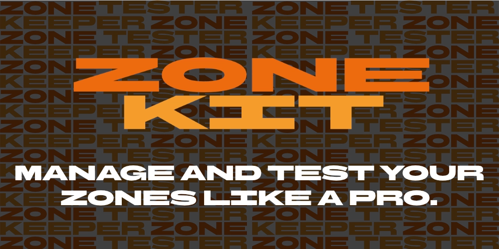

  

**ZoneKit is your one-stop-shop for managing multiple Cloudflare Zones in one place.**

It provides two tools: ZoneKeeper and ZoneTester. ZoneKeeper syncs configurations between multiple Cloudflare zones, and 
ZoneTester allows you to see what they look like to the outside world.

Using ZoneKeeper with a team, across multiple computers, or just want reliable backups of your profiles? Enable ZoneKit
Cloud for free to share and backup your profiles privately and securely via your Cloudflare account's KV storage.

---

  

**ZoneKeeper syncs rules and settings across multiple Cloudflare Zones via profiles and parent domains. This allows you 
to create pseudo-global WAF rules, page redirect rules, SSL/TLS/HTTPS settings, compliance, email settings, and more.**

ZoneKeeper's Sync tool automatically detects discrepancies in configurations for zones in profiles and resolves them 
with one click.

Profiles are incredibly flexible, and can apply all the rules or just some of them, allowing you to use multiple 
profiles and mix-and-match them across zones. Want something more simple? You can also manage individual zones, or just 
use a single profile to sync them all together.

It's designed for anyone running several zones who'd rather not set up the same rules and settings on each one by hand. 
Every zone keeps its own configuration in Cloudflare, ZoneKeeper simply keeps them consistent for you.

---

  

**ZoneTester shows you what your domain's zones look like to the outside world. Conduct DNS Lookups, search for 
subdomains, and run security audits on your SSL/TLS certificates all in one place.**

---

  

**ZoneKit Cloud is a free cloud backup and synchronisation tool for ZoneKeeper profiles. It's useful to enable ZoneKit 
Cloud if you're working with a team, across multiple computers, or would like backups in case something goes wrong.**

By default, ZoneKeeper keeps your profiles in files on your computer. Turn on ZoneKit Cloud in Settings to store them in
your Cloudflare account's Workers KV instead so they follow you to any computer signed in to that account. Anyone who
has access to your Cloudflare organisation can access them.

ZoneKit Cloud is free. Everything is saved as a single KV value, ZoneKeeper keeps writes to a minimum and stores data in
a single KV value so even high usage should not exceed Cloudflare's free daily limits, if you're on the free plan this
will not charge you if you do exceed it. ZoneKeeper keeps a local copy so it opens instantly and works offline, uploads
your changes a moment after you make them, and downloads newer copies made on other computers. If two computers change
it at the same time, ZoneKeeper asks which copy to keep rather than overwriting either.

Your API token needs the Account, Workers KV Storage, Edit permission. ZoneKeeper creates a KV namespace called
`ZoneKit` in the account you choose.

---

<small>
    ZoneKit is not affiliated with or endorsed by Cloudflare, AWS, or any other services mentioned within the app.
    Cloudflare and the Cloudflare logo are trademarks and/or registered trademarks of Cloudflare, Inc. in the United 
    States and other jurisdictions.
</small>